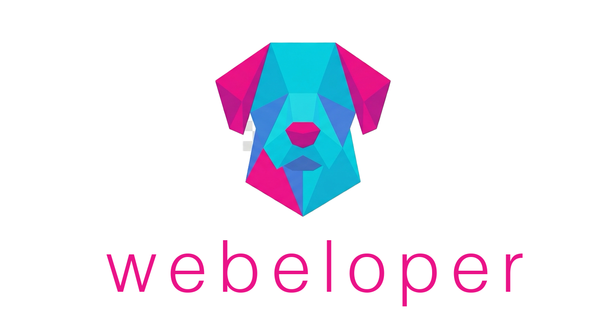

<p align="center">
  
</p>

<h1 align="center">Webeloper</h1>

<p align="center">
  <strong>From a sales chat to a client-ready website demo. With a process you control.</strong><br>
  <em>De una conversación de ventas a una demo de web para tu cliente. Con un proceso que controlás.</em>
</p>

<p align="center">
  <a href="https://ko-fi.com/mrnandz"></a>
  <a href="https://cafecito.app/mrnandz"></a>
  
</p>

---

# English

## Why Webeloper?

If you build websites for clients — as a freelancer, an agency, or someone who uses AI to move faster — you already know how it usually goes:

- Sales conversations live in scattered chats and get lost the moment you switch to building.
- The handoff between "what the client wants" and "what gets built" is where context dies.
- AI agents help, but without guardrails they invent facts, go off-brief, and produce generic results.
- Every project feels like starting from zero. There is no process. Just vibes and luck.

Webeloper fixes that. It gives you a **repeatable process** for the whole lifecycle of a client website — from the first sales message to a finished demo — with clear roles, clear contracts, and you in control at every step.

Three AI agents, two contract documents, one pipeline: **Sales → Design → Build**.

## What you get

- **A real process, not a wildcard.** Every stage has a defined agent and a contract that works as the source of truth for that stage. No more chaos between "we talked" and "we deliver".
- **Context that survives.** Commercial context is captured in the `sales-contract.md`, handed off to design, and turned into a complete `project-contract.md` — nothing gets lost between stages.
- **You stay in control.** Agents research, qualify and draft communications, but they never perform external outreach without human approval. Facts must be verifiable, and hypotheses remain explicitly hypotheses.
- **Less rework, faster demos.** The designer produces a spec detailed enough that the developer builds it right the first time. You skip the "that's not what I meant" loop.
- **Not another template site.** The system is conversion-first: every website defines a clear primary conversion and is designed for the specific business. Your demos feel intentional, not generic.
- **Design judgment, enforced.** The `design-judgment` skill makes the Designer Agent earn every visual decision. It rejects statistical defaults, requires a written visual thesis, forces three genuinely different directions before choosing, and demands evidence behind each contract decision.
- **Works with tools you already use.** Runs on [opencode](https://opencode.ai) — no enterprise stack, no license fees, no vendor lock-in. Open source under MIT.

## What Webeloper is not

Webeloper is not:

- an automatic website generator;
- a chatbot that replaces an agency;
- a web framework;
- a system that decides for you;
- a set of prompts to copy and paste.

It is a multi-agent work process with defined roles, explicit contracts and human supervision.

## How it works

```
┌─────────────┐    ┌──────────────────┐    ┌───────────────┐    ┌─────────────┐    ┌──────────┐
│  Prospect   │ →  │  Sales Agent     │ →  │ Designer Agent│ →  │ Developer   │ →  │ Website  │
│  discovery  │    │  sales-contract  │    │ project-      │    │ Agent       │    │ (demo)   │
│             │    │  (Design Handoff)│    │ contract.md   │    │              │    │          │
└─────────────┘    └──────────────────┘    └───────────────┘    └─────────────┘    └──────────┘
```

1. **Sales Agent** researches and qualifies prospects, and keeps a `sales-contract.md` for each one.
2. When a prospect asks for a demo, the Sales Agent writes a **Design Handoff** — business context, not UI decisions.
3. **Designer Agent** reads the handoff and produces `project-contract.md`, a complete, build-ready specification. The `design-judgment` skill governs this stage: visual thesis, three explored directions, and a reason behind every decision.
4. **Developer Agent** builds the functional website from that contract — the single source of truth for the design.

## Who it's for

- **Freelancers** who want to look like a team and stop reinventing the process on every project.
- **Agencies** that need consistent handoffs between sales, design and delivery.
- **AI users** who want to generate websites with guardrails instead of chaos.

## See it in action

The Sales Agent is designed around real conversational commands. A session can look like this:

```
you:   find 10 gyms in Buenos Aires
agent: discovers, researches and qualifies prospects, ranked with reasoning.

you:   let's work on prospect #02
agent: prepares its sales-contract.md and Design Handoff.

you:   contact prospect #02
agent: drafts the outreach message for your approval.

you:   prospect #02 wants to see the site
agent: updates the status to demo_requested and completes the Design Handoff.
```

Then the Designer Agent turns that handoff into `project-contract.md`, and the Developer Agent builds the demo. From "does someone want a website?" to "here's your website" — one pipeline, no context lost.

## Get started in 4 steps

Requires [opencode](https://opencode.ai) (or any runtime that supports markdown agent definitions).

**1. Install the agents**

```bash
mkdir -p .opencode/agents
cp Agents/*.md .opencode/agents/
```

**2. Copy the contract templates**

```bash
cp Contracts/sales-contract.md .
cp Contracts/project-contract.md .
```

**3. Install the design skill**

```bash
mkdir -p .opencode/skills
cp -r Skills/design-judgment .opencode/skills/
```

**4. Open opencode and start**

Pick a prospect, research it with the Sales Agent, and let the pipeline do the rest. The agents are designed so that you never have to hand-hold the process.

## Project layout

```
Webeloper/
├── Agents/
│   ├── sales-agent.md       # Prospects & sells → maintains sales-contract.md
│   ├── designer-agent.md    # Designs websites → writes project-contract.md
│   └── developer-agent.md   # Builds websites from project-contract.md
├── Contracts/
│   ├── sales-contract.md    # Commercial spec template (Sales's output)
│   └── project-contract.md  # Implementation spec template (Designer's output)
├── Skills/
│   └── design-judgment/     # Forces deliberate art direction over defaults
│       ├── SKILL.md
│       └── rules/           # The five criteria (a–e)
└── logo.png                 # Project logo
```

## Contributing

Ideas, improvements and pull requests are welcome. See [CONTRIBUTING.md](CONTRIBUTING.md).

## Support the project

If Webeloper saves you time, buy me a coffee ☕

- [Cafecito](https://cafecito.app/mrnandz)
- [Ko-fi](https://ko-fi.com/mrnandz)

Your support keeps the project alive and improving. Thank you!

## License

MIT — see [LICENSE](LICENSE). Use it, share it, build on it.

---

# Español (Latinoamérica)

## ¿Por qué Webeloper?

Si hacés sitios web para clientes — como freelancer, agencia, o alguien que usa IA para avanzar más rápido — ya sabés cómo suele terminar:

- Las conversaciones de ventas viven en chats dispersos y se pierden en cuanto pasás a construir.
- El traspaso entre "lo que el cliente quiere" y "lo que se construye" es donde muere el contexto.
- Los agentes de IA ayudan, pero sin reglas inventan hechos, se van del brief y producen resultados genéricos.
- Cada proyecto parece empezar de cero. No hay proceso. Solo intuición y suerte.

Webeloper arregla eso. Te da un **proceso repetible** para todo el ciclo de vida de una web de cliente — desde el primer mensaje de ventas hasta la demo terminada — con roles claros, contratos claros, y vos al control en cada paso.

Tres agentes de IA, dos documentos de contrato, un pipeline: **Ventas → Diseño → Desarrollo**.

## Lo que obtenés

- **Un proceso real, no un comodín.** Cada etapa tiene un agente definido y un contrato que funciona como fuente de verdad para esa etapa. Se acabó el caos entre "hablamos" y "entregamos".
- **El contexto sobrevive.** El contexto comercial se captura en el `sales-contract.md`, se entrega a diseño y se convierte en un `project-contract.md` completo — nada se pierde entre etapas.
- **Vos tenés el control.** Los agentes investigan, califican y redactan comunicaciones, pero nunca realizan outreach externo sin aprobación humana. Los hechos deben ser verificables y las hipótesis permanecen explícitamente como hipótesis.
- **Menos retrabajo, demos más rápido.** El diseñador produce una especificación tan detallada que el desarrollador la construye bien a la primera. Te ahorrás el loop de "no era lo que quería decir".
- **No es otro sitio plantilla.** El sistema es conversion-first: cada web define una conversión primaria clara y se diseña para el negocio específico. Tus demos se sienten intencionales, no genéricas.
- **Criterio de diseño, garantizado.** La skill `design-judgment` obliga al Agente de Diseño a ganarse cada decisión visual. Rechaza los patrones por defecto, exige una tesis visual escrita, fuerza tres direcciones realmente distintas antes de elegir, y pide evidencia detrás de cada decisión del contrato.
- **Funciona con herramientas que ya usás.** Corre sobre [opencode](https://opencode.ai) — sin stack empresarial, sin licencias, sin vendor lock-in. Código abierto con MIT.

## Lo que Webeloper no es

Webeloper no es:

- un generador automático de sitios;
- un chatbot que reemplaza una agencia;
- un framework web;
- un sistema que decide por vos;
- un conjunto de prompts para copiar y pegar.

Es un proceso de trabajo multiagente con roles definidos, contratos explícitos y supervisión humana.

## Cómo funciona

```
┌───────────────┐    ┌──────────────────┐    ┌────────────────┐    ┌──────────────┐    ┌──────────┐
│  Descubrir    │ →  │  Agente de       │ →  │ Agente de      │ →  │ Agente de    │ →  │ Sitio    │
│  prospecto    │    │  Ventas          │    │ Diseño         │    │ Desarrollo   │    │ web (demo)│
│               │    │  sales-contract  │    │ project-       │    │               │    │          │
│               │    │  (Design Handoff)│    │ contract.md    │    │               │    │          │
└───────────────┘    └──────────────────┘    └────────────────┘    └──────────────┘    └──────────┘
```

1. El **Agente de Ventas** investiga y califica prospectos, y mantiene un `sales-contract.md` para cada uno.
2. Cuando un prospecto pide una demo, el Agente de Ventas escribe un **Design Handoff** — contexto de negocio, no decisiones de UI.
3. El **Agente de Diseño** lee el handoff y produce el `project-contract.md`, una especificación completa y lista para construir. La skill `design-judgment` gobierna esta etapa: tesis visual, tres direcciones exploradas y un motivo detrás de cada decisión.
4. El **Agente de Desarrollo** construye el sitio funcional a partir de ese contrato — la única fuente de verdad del diseño.

## ¿Para quién es?

- **Freelancers** que quieren parecer un equipo y dejar de reinventar el proceso en cada proyecto.
- **Agencias** que necesitan traspasos consistentes entre ventas, diseño y entrega.
- **Usuarios de IA** que quieren generar webs con reglas en vez de caos.

## Míralo en acción

El Agente de Ventas está pensado con comandos conversacionales reales. Una sesión puede verse así:

```
vos:   encontrá 10 gimnasios en Buenos Aires
agente: descubre, investiga y califica prospectos, ordenados con su razonamiento.

vos:   hagamos el 02
agente: prepara su sales-contract.md y el Design Handoff.

vos:   contactemos al 02
agente: redacta el mensaje de outreach para tu aprobación.

vos:   el 02 pidió ver la web
agente: actualiza el estado a demo_requested y completa el Design Handoff.
```

Después el Agente de Diseño convierte ese handoff en `project-contract.md`, y el Agente de Desarrollo construye la demo. De "¿alguien quiere una web?" a "acá tenés tu web" — un solo pipeline, sin perder contexto.

## Primeros pasos en 4 pasos

Requiere [opencode](https://opencode.ai) (o cualquier runtime que soporte definiciones de agentes en markdown).

**1. Instalá los agentes**

```bash
mkdir -p .opencode/agents
cp Agents/*.md .opencode/agents/
```

**2. Copiá las plantillas de contratos**

```bash
cp Contracts/sales-contract.md .
cp Contracts/project-contract.md .
```

**3. Instalá la skill de diseño**

```bash
mkdir -p .opencode/skills
cp -r Skills/design-judgment .opencode/skills/
```

**4. Abrí opencode y empezá**

Elegí un prospecto, investigalo con el Agente de Ventas, y dejá que el pipeline haga el resto. Los agentes están diseñados para que no tengas que llevar el proceso de la mano.

## Estructura del proyecto

```
Webeloper/
├── Agents/
│   ├── sales-agent.md       # Prospecta y vende → mantiene sales-contract.md
│   ├── designer-agent.md    # Diseña sitios web → escribe project-contract.md
│   └── developer-agent.md   # Construye sitios web desde project-contract.md
├── Contracts/
│   ├── sales-contract.md    # Plantilla de especificación comercial (salida de Ventas)
│   └── project-contract.md  # Plantilla de especificación de implementación (salida del Diseñador)
├── Skills/
│   └── design-judgment/     # Obliga una dirección de arte deliberada en vez de defaults
│       ├── SKILL.md
│       └── rules/           # Los cinco criterios (a–e)
└── logo.png                 # Logo del proyecto
```

## Contribuciones

Ideas, mejoras y pull requests son bienvenidas. Consultá [CONTRIBUTING.md](CONTRIBUTING.md).

## Apoyá el proyecto

Si Webeloper te ahorra tiempo, invitame un cafecito ☕

- [Cafecito](https://cafecito.app/mrnandz)
- [Ko-fi](https://ko-fi.com/mrnandz)

Tu apoyo mantiene el proyecto vivo y mejorando. ¡Gracias!

## Licencia

MIT — ver [LICENSE](LICENSE). Usalo, compartilo, construí sobre él.
